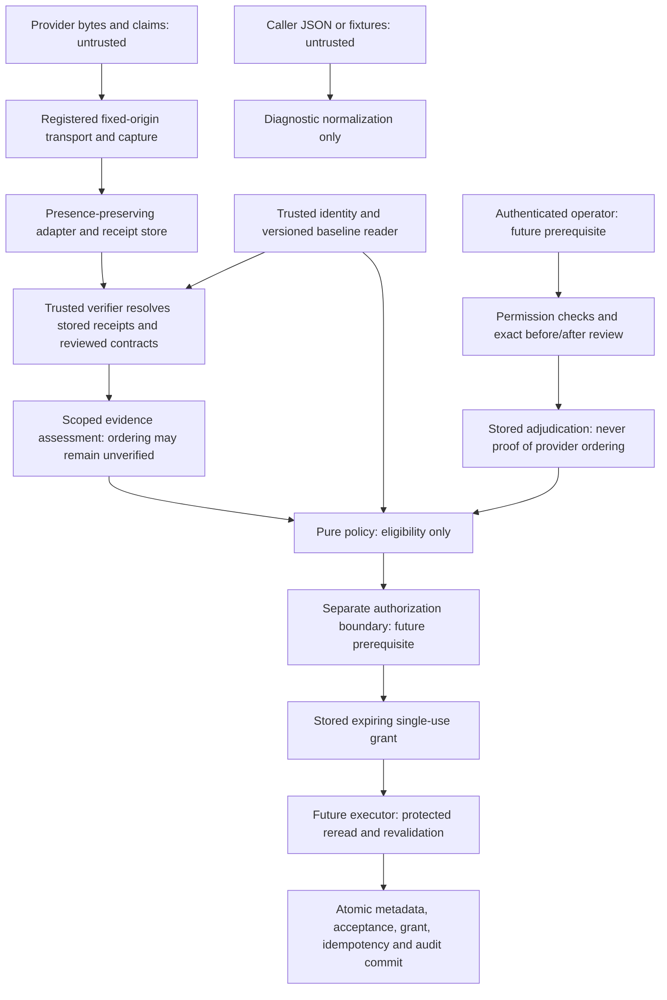

# Phase 2.9D — Reviewed evidence contracts and operator corrections

Status: documentation-only specification, 2026-10-18, `phase/02-backend`.
All proposed C# shapes and storage below are design examples, not implemented contracts.
No runtime, endpoint, schema, data or frontend changes are included. No writer or automatic
approval is authorized. Current `Approved` remains unreachable and persistence authorization
is always false. Specialist review of this design does not constitute product approval.

## Repository baseline and decisions

This specification refines [2.9A](match-synchronization-policy.md), preserves implemented
[2.9B](phase-02-9b-match-synchronization-policy.md), and concretizes
[2.9C](phase-02-9c-provider-evidence-and-corrections.md). The 2.9C provider investigation
did not locate verified football-data.org ordering/revision guarantees. No new provider
guarantee is asserted here; increasing `lastUpdated`, repeated responses and HTTPS captures
still cannot establish supersession. The official references and their limitations remain
in 2.9C; this phase makes no provider requests and does not reinterpret documentation absence
as proof that a provider feature cannot exist.

| Inspected source | Actual behavior / constraint |
| --- | --- |
| [Observation](../src/SportStats.Application/Football/Ingestion/MatchProviderObservation.cs) | `MatchProviderObservation` is an inert public record with presence-aware fields, source, raw status, provider update time and caller retrieval time. No receipt/authenticity mechanism. |
| [Normalized identities](../src/SportStats.Application/Football/Ingestion/NormalizedFootballData.cs), [normalizer](../src/SportStats.Infrastructure/FootballData/FootballDataObservationNormalizer.cs) | Exact provider/scope/external-ID tuple. Match scope is `competition:PL/season:{queryYear}`, team scope `competition:PL`. Normalizer validates season and reads only `score.fullTime.home/away`; source label is a constant, not a transport attestation. |
| [Transport](../src/SportStats.Infrastructure/FootballData/FootballDataClient.cs), [HTTP contract](../src/SportStats.Application/Football/Ingestion/IFootballDataClient.cs) | Fixed HTTPS host/path; status/date/byte count only. No revision comparator, receipt, ETag or conditional request interface. Actual match request omits season; bind response season and normalization queryYear rather than invent a requested season. |
| [Policy contracts](../src/SportStats.Application/Football/MatchSynchronization/MatchSynchronizationContracts.cs), [engine](../src/SportStats.Application/Football/MatchSynchronization/MatchSynchronizationPolicyEngine.cs) | Input is observations plus identity snapshot. Internally invokes evaluator, retains atomic per-observation candidates. Evidence has unverified freshness/false authority. No evidence or operator input can enable `Approved`. Policy version is `2.9B.1`. |
| [Metadata contracts](../src/SportStats.Application/Football/MatchMetadata/MatchMetadataContracts.cs), [read service](../src/SportStats.Infrastructure/Persistence/MatchMetadata/MatchMetadataEvaluationService.cs) | Trusted snapshots are a caller boundary, not authentication. No metadata version exists; reads are best effort, not transactional write validation. |
| [API startup](../src/SportStats.Api/Program.cs), [infrastructure registration](../src/SportStats.Infrastructure/DependencyInjection.cs) | Only health endpoint; no registered operator authentication/authorization, receipt verifier, review/grant or correction-audit service. A provider API token is not operator identity. |
| [Match](../src/SportStats.Domain/Football/FootballMatch.cs), [DbContext](../src/SportStats.Infrastructure/Persistence/SportStatsDbContext.cs), [EF configuration](../src/SportStats.Infrastructure/Persistence/EntityConfigurations.cs) | No metadata concurrency version, acceptance chain, evidence state, review/grant/idempotency/audit entities. External mapping tuple indexes are nonunique. |

Keep exact identity and immutable season/ordered participants. Preserve Missing/Null/Value
and coherent score-pair requirements. No natural-key rematching, cross-observation splicing,
provider ranking, implicit baseline adoption or NoChange watermark advancement is introduced.

## Trust-boundary diagram



Only registered ingestion may attest capture. Only the trusted evidence verifier may
produce a verified ordering assessment, after resolving protected receipts, reviewed
contract applicability and an accepted baseline. Only a separately authorized review
service may produce operator adjudication; only the separate authorization service may
issue a persistence grant. Those services/stores do not exist today.

Public IDs, enums and records carry data, not authority. Resolve their server-held contents
and caller permissions at every boundary. Internal/private constructors prevent accidental
misuse but do not authenticate a caller, defeat reflection or protect against compromised
in-process code. Trust requires controlled composition, registered implementations, protected
storage and later transactional revalidation. Never deserialize a trusted class from HTTP,
accept an arbitrary caller-supplied verifier implementation, or infer trust from its type name.

## Proposed typed C# shapes

Documentation notation uses existing `ProviderIdentity`, `MatchProviderObservation`,
`MatchObservationField<T>`, `MatchMetadataSnapshot`, `MatchMetadataField` and
`MatchSynchronizationOutcome`. All collections are frozen defensive copies; `IReadOnlyList`
alone is insufficient. IDs must be nonempty, versions nonnegative, references resolvable,
field sets nonempty/unique where applicable, and enum values validated. Constructor bodies
and exhaustive storage types are intentionally omitted; these snippets are not compile-ready.

```csharp
// Public inert inputs and references. A Reference never authenticates its target.
public readonly record struct EvidenceId(Guid Value);
public readonly record struct ReceiptId(Guid Value);
public readonly record struct ReviewId(Guid Value);
public readonly record struct GrantId(Guid Value);
public sealed record Fingerprint(string Schema, string Algorithm, string LowerHex);

public sealed record RawProviderObservation(
    ReceiptId? CaptureReference, MatchProviderObservation Observation);
public sealed record UnverifiedProviderMetadata(
    MatchObservationField<DateTime> LastUpdatedUtc,
    string? ClaimedRevision, string? ETag, DateTimeOffset? LastModifiedUtc);
// ClaimedRevision/HTTP validators are optional diagnostics, not current client outputs.

public sealed record IdentityBinding(
    ProviderIdentity MatchIdentity, Guid CanonicalMatchId,
    ProviderIdentity SeasonIdentity, Guid CanonicalSeasonId,
    ProviderIdentity HomeIdentity, Guid CanonicalHomeTeamId,
    ProviderIdentity AwayIdentity, Guid CanonicalAwayTeamId,
    Fingerprint MappingDependencyDigest, long MappingGeneration);
public enum EvidenceSourceKind { ProviderCapture, OperatorAttachment }
public sealed record EvidenceSourceReference(
    Guid Id, EvidenceSourceKind Kind, string RegisteredSourceKey, string AdapterVersion);
public enum EvidenceValidationResult { Unverified, Valid, Invalid, Expired, Revoked }
public sealed record EvidenceValidationReport(
    EvidenceValidationResult Result, string VerifierVersion,
    IReadOnlyList<string> StableReasonCodes);
// Valid means validation for the stated purpose; not all claims become verified.

public sealed record ObservationReceiptView(
    ReceiptId Id, EvidenceSourceReference Source, ProviderIdentity MatchIdentity,
    Fingerprint RawBodyDigest, Fingerprint ObservationFingerprint,
    MatchProviderObservation Observation, UnverifiedProviderMetadata Claims,
    Guid RequestCaptureId, DateTimeOffset CapturedAtUtc);
// Actual protected receipt also retains registered request context and safe payload ref.

public sealed record ExpectedState(
    IdentityBinding Identity, MatchMetadataSnapshot Before, long MetadataVersion,
    Guid? AcceptedHeadId, long EvidenceGeneration,
    string PolicyVersion, string AuthorityConfigurationVersion);
public enum OrderingRelation {
    Unverified, Newer, SameRevision, Older, Incomparable, Contradictory
}
public sealed record OrderingScope(
    ProviderIdentity MatchIdentity, string Stream, string Epoch,
    string Representation, IReadOnlyList<MatchMetadataField> CoveredFields);

// Trusted assembly implementation, no public constructor/init/setter or record 'with'.
// The concrete verifier builds these only after validating stored evidence.
public sealed class VerifiedOrderingEvidence {
    private VerifiedOrderingEvidence() { /* trusted construction omitted */ }
    public EvidenceId Id { get; }
    public ReceiptId Receipt { get; }
    public Fingerprint ObservationFingerprint { get; }
    public IdentityBinding Identity { get; }
    public Guid ComparedAcceptanceId { get; }
    public long ComparedEvidenceGeneration { get; }
    public OrderingScope Scope { get; }
    public string ContractVersion { get; }
    public string RevisionToken { get; }
    public OrderingRelation Relation { get; } // Newer/SameRevision/Older only with contract
    public EvidenceValidationReport Validation { get; }
}
// No verified instance for football-data.org ordering under current known contracts.
public sealed record OrderingAssessmentView(
    OrderingRelation Relation, EvidenceId? VerifiedReference,
    IReadOnlyList<string> StableReasonCodes);

public enum CorrectionAction {
    MetadataCorrection, FinishedScoreCorrection, ExceptionalTransition,
    NullableClear, BaselineAdoption, AuthorityHandback
}
public sealed record CorrectionProposal(
    Guid RequestId, ExpectedState Expected, CorrectionAction Action,
    IReadOnlyList<CorrectionAction> RequiredActions,
    MatchObservationField<DateTime> KickoffUtc, MatchObservationField<int> Matchday,
    MatchObservationField<FootballMatchStatus> Status,
    MatchObservationField<int> HomeGoals, MatchObservationField<int> AwayGoals,
    MatchMetadataSnapshot After, Fingerprint CandidateDigest,
    IReadOnlyList<ReceiptId> SupportingReceipts,
    IReadOnlyList<EvidenceId> SupportingEvidence, IReadOnlyList<Guid> ConflictIds,
    string Reason);
public enum ReviewDisposition { Accept, Reject, Defer }
public sealed record AuthenticatedSubject(string Issuer, string SubjectId);

public sealed class OperatorReviewedCorrectionEvidence {
    private OperatorReviewedCorrectionEvidence() { /* trusted construction omitted */ }
    public EvidenceId Id { get; }
    public ReviewId Review { get; }
    public Guid RequestId { get; }
    public ExpectedState Expected { get; }
    public Fingerprint CandidateDigest { get; }
    public CorrectionAction Action { get; }
    public IReadOnlyList<CorrectionAction> RequiredActions { get; }
    public IReadOnlyList<MatchMetadataField> PermittedFields { get; }
    public IReadOnlyList<EvidenceId> SupportingEvidence { get; }
    public IReadOnlyList<Guid> ResolvedConflictIds { get; }
    public AuthenticatedSubject Reviewer { get; }
    public string PermissionPolicyVersion { get; }
    public DateTimeOffset ReviewedAtUtc { get; }
    public DateTimeOffset ValidUntilUtc { get; }
    public EvidenceValidationReport Validation { get; }
    public OrderingRelation ProviderOrdering => OrderingRelation.Unverified;
}

public enum AuthorityDisposition { Unverified, Permitted, Denied }
public abstract record EvidenceSubject;
public sealed record ProviderObservationSubject(
    ReceiptId Receipt, Fingerprint ObservationFingerprint) : EvidenceSubject;
public sealed record OperatorProposalSubject(
    Guid RequestId, Fingerprint CandidateDigest) : EvidenceSubject;
public sealed record ScopedEvidenceAssessmentView(
    EvidenceId AssessmentId, ExpectedState Expected,
    EvidenceSubject Subject, Fingerprint CandidateDigest,
    OrderingAssessmentView Ordering, EvidenceId? AdjudicationReference,
    AuthorityDisposition Authority, string AuthorityConfigurationVersion,
    IReadOnlyList<MatchMetadataField> SemanticallyValidatedFields,
    IReadOnlyList<EvidenceId> SemanticEvidenceReferences,
    EvidenceValidationReport Validation, IReadOnlyList<Guid> UnresolvedConflictIds);
// This view is diagnostic. The trusted orchestrator resolves/recomputes its contents.
// Authority and semantic fields are validated by registered services, never caller flags.

public sealed record PolicyDecisionView(
    Guid DecisionId, ExpectedState Expected, Fingerprint CandidateDigest,
    IReadOnlyList<EvidenceId> Evidence, MatchSynchronizationOutcome Outcome,
    IReadOnlyList<string> Reasons) {
    public bool IsUpdateAuthorized => false;
}
// Future-only stored authorization; no public grant constructor or operator DTO input.
public sealed class PersistenceAuthorization {
    private PersistenceAuthorization() { /* separate authority construction omitted */ }
    public GrantId Id { get; }
    public ReviewId Review { get; }
    public Guid DecisionId { get; }
    public Fingerprint AuthorizedCommandDigest { get; }
    public ExpectedState Expected { get; }
    public AuthenticatedSubject Executor { get; }
    public CorrectionAction Action { get; }
    public IReadOnlyList<CorrectionAction> RequiredActions { get; }
    public IReadOnlyList<MatchMetadataField> PermittedFields { get; }
    public DateTimeOffset IssuedAtUtc { get; }
    public DateTimeOffset ExpiresAtUtc { get; }
    // Revocation and consumption state live in protected storage, not mutable DTO flags.
}
```

An observation need not have a canonical match ID before resolution. The fingerprint
binds provider identity; the separate trusted `IdentityBinding` binds canonical IDs and
mapping dependencies. Missing/ambiguous mappings produce no trusted binding. A receipt
with valid origin can still have unverified ordering, invalid identity or unsupported
semantics. Validation reports always name purpose through their enclosing contract and
reason codes; `Valid` cannot be used as a universal approval flag.

The future pure policy may receive immutable verified assessments from trusted orchestration;
its public diagnostic views are never trusted input at a persistence boundary. Existing 2.9B
input/output remain unchanged. Evidence attachment references supplement an exact operator
proposal; they do not require inventing a provider observation when the operator chose a
different value. A provider-only assessment binds an observation; an operator assessment
binds its proposal digest and referenced receipts. `EvidenceSubject` discriminates those
cases without a fictitious provider observation for an operator. Unknown subject variants
are rejected, and an operator subject cannot carry a provider Newer assertion.

`Action` names the primary workflow only. Trusted validation derives the complete
`RequiredActions` set from Before, proposal and After and requires every applicable permission;
for example, one atomic proposal can need FinishedScoreCorrection, NullableClear and
ExceptionalTransition together. Bind that sorted unique set into review/command/grant; never
trust a caller-selected MetadataCorrection label to bypass a more restrictive permission.

## Canonical observation fingerprint: SS-MATCH-OBS/1

Purpose: deterministic equality/integrity for a normalized provider observation. This is
not a signature, identity resolver, chronology indicator, complete source representation
or idempotency key. Two receipts can share one fingerprint. Provider revision conflict
comparison must use only the contract-covered semantic projection; the entire fingerprint
also contains diagnostics that may change legitimately.

Define the bytes directly, independently of JSON serializer defaults, culture, enum numeric
values, platform newline and runtime version:

1. Begin with ASCII `SS-MATCH-OBS/1` followed by one zero byte (`00` hex).
2. Append fields in the exact order below, without names, whitespace or separators other
   than the specified encodings. No optional field may be omitted from this sequence.
3. `S(x)` is a four-byte unsigned big-endian UTF-8 byte length, then strict UTF-8 bytes,
   without BOM. Reject invalid Unicode/unpaired surrogates. Preserve exact ordinal string
   code points: no trimming, case-folding or Unicode normalization. Registry validation occurs
   first; values that require coercion are invalid input, not repaired during hashing.
4. `I(x)` is `S` of the invariant base-10 integer: no leading plus/zeros except `0`, no
   grouping. `D(x)` is `S` of invariant Gregorian `yyyy-MM-dd`, using ASCII digits;
   date years and QueryYear are in 1–9999. T uses the same invariant Gregorian/ASCII rules.
5. `T(x)` is `S` of UTC `yyyy-MM-dd'T'HH:mm:ss.fffffff'Z'` at .NET tick precision.
   Require `DateTimeKind.Utc`; never assume a Local/Unspecified value is UTC. The registered
   adapter already accepts only zero-offset provider timestamps. Seven digits avoid loss
   of supported precision; equivalent fractional spellings normalize identically.
6. `P(field, encode)` is one byte: Missing=`00`, Null=`01`, Value=`02`; only Value is
   followed by its encoded value. Presence/value disagreement or undefined presence fails.
   `N(string)` is `00` for null, otherwise `01` followed by `S(string)`; empty differs from null.
7. Hash all bytes with SHA-256. Expose `{Schema:"SS-MATCH-OBS/1", Algorithm:"SHA-256",
   LowerHex:<64 lowercase hex digits>}`. Compare schema/algorithm as well as digest; no
   truncated digest, runtime `GetHashCode` or automatic cross-schema equality.

| Order | Field | Encoding |
| --- | --- | --- |
| 1–3 | Match Identity: ProviderKey, IdentityScope, ExternalId | S each |
| 4–6 | Season.Identity: ProviderKey, IdentityScope, ExternalId | S each |
| 7–10 | Season.QueryYear, Season.Key, Season.StartDate, Season.EndDate | I, S, D, D |
| 11–13 | HomeTeam: ProviderKey, IdentityScope, ExternalId | S each |
| 14–16 | AwayTeam: ProviderKey, IdentityScope, ExternalId | S each |
| 17–18 | Source.ProviderKey, Source.Endpoint | S each |
| 19 | KickoffUtc | P(T) |
| 20 | Matchday | P(I) |
| 21 | Status | P(S of stable token below) |
| 22–23 | HomeGoals, AwayGoals | P(I) each |
| 24 | ProviderLastUpdatedUtc (unverified claim) | P(T) |
| 25 | RawProviderStatus (diagnostic only) | N |

Stable status tokens are exactly `Scheduled`, `Live`, `Finished`, `Postponed`, `Cancelled`,
`Suspended`. Status Missing is encodable. Explicit status Null, Unknown, undefined enum or
unsupported normalized status is invalid for this accepted fingerprint schema. Raw status
is never reparsed as an alternate authority: `TIMED` can accompany normalized Scheduled;
AWARDED normalized Unknown fails. Keep invalid/unsupported input in a rejected-capture
diagnostic with a raw-body digest; do not substitute Unknown, zero or an empty fingerprint.
No accepted observation fingerprint is issued for that invalid input.

Validate UTC fields, positive matchday, nonnegative goals, exact source/provider consistency,
season/queryYear consistency, nonempty identities and distinct participants using registered
adapter/evaluator validation before hashing. This fingerprint boundary cannot itself establish
that a valid-looking season/team maps to a canonical entity. Bound input sizes before encoding;
the existing transport body bound remains applicable, and provider-specific text limits must
be explicit in the implementation. Rejection must not truncate input silently.

`RetrievedAtUtc`, receipt/request IDs, captured time, canonical IDs, mapping state, adapter
version, caller identity, ETag and claimed revision extras are excluded. Store them in the
receipt envelope; they cannot change normalized observation equality. ProviderLastUpdated
and raw status are included because they are retained observation content, without asserting
trust. A distinct raw-body SHA-256 covers exact response bytes. Unobserved duration/period
fields are not covered by SS-MATCH-OBS/1: evidence needing them requires a reviewed adapter
and new schema, not trust in this digest.

For revision equivocation, serialize only the documented covered fields with the same P/value
encodings and explicit ordered field names under a separate domain `SS-MATCH-COVERAGE/1`;
bind provider tuple, stream/epoch, representation and contract version. Do not compare two
SS-MATCH-OBS hashes alone to claim equal-revision semantic conflict.

Candidate/command binding is a different domain `SS-MATCH-CORRECTION/1`: serialize an ordered
length-prefixed sequence containing request ID, primary action and derived required-action set,
all canonical/provider identity and
mapping dependencies, complete Before/version, presence-aware five-field proposal, complete
After, accepted head/evidence generation, policy/authority versions, supporting receipt/evidence
IDs, resolved conflict IDs and reason. GUIDs use invariant lowercase `D` format; nullable IDs
use a presence byte; versions use I; lists use four-byte big-endian count and ordinally sorted
unique IDs/field tokens. Reject duplicates, never silently remove them. Full snapshots encode
Kickoff/Matchday/goals with explicit Null/Value and status with its stable token; Missing exists
only on the proposal. Bind immutable canonical IDs as well. A legacy Before status Unknown
may use the diagnostic token `Unknown`; proposed observed/After Unknown is not eligible.
Use the same SHA-256 envelope. The future implementation must publish exact field-by-field
command serialization and golden vectors before enabling review/grants; do not improvise
reflection or JSON hashing. `AuthorizedCommandDigest` additionally binds decision/review IDs,
executor identity, permitted fields, permission-policy version and grant validity under its
own versioned domain. These command formats are prerequisites, not implemented features.

Required fingerprint examples: P Missing=`00`; P Null=`01`; P Value(0)=`02 00 00 00 01 30`
(hex). The canonical encoder emits `1`, never `01`. This constrains canonical bytes, not
the provider's original number spelling: accepted provider numeric forms follow the registered
normalizer and hash the resulting typed integer. Raw lexical differences remain in body digests.
`2026-10-18T12:00:00Z` and `.0000000Z` normalize identically; changing retrieval time does
not change a fingerprint, changing ProviderLastUpdated does. Missing, Null and Value(0)
must produce distinct canonical bytes and golden hashes in the implementation phase.

## Operator correction workflow and unavailable prerequisites

There is no trusted operator pathway today. API startup lacks authentication middleware,
permission policies and operator endpoints; persistence lacks review/grant/audit stores and
canonical versions. A username string, `IsAdmin`, provider token, local machine access or
manually created review record is not a substitute. The following workflow cannot run until
identity assurance, authorization, durable storage and transaction support are approved.

1. **Authenticate and scope.** Use a supported identity provider and validated session/token.
   Resolve immutable issuer/subject server-side; ignore body-supplied actor IDs and role labels.
   Check action/competition/match/field permission, including separate finished-score,
   nullable-clear, exceptional-transition, baseline-adoption and authority-handback powers.
   Authenticate attachments and review access separately from correction execution.
2. **Create immutable request.** Server loads exact mappings and expected canonical version,
   captures complete Before, computes presence-aware proposal and resulting After, and
   records reason, attachments/references, known conflicts and evidence generation. Evidence
   attachment is a reference to a bounded controlled object with immutable digest, source,
   access controls and validation report; an arbitrary URL or “official” label is unverified.
   Do not fetch arbitrary URLs in a transaction or treat attachments as provider revisions.
3. **Review exact before/after.** Show all changed and retained values, explicit clears,
   score-pair presence, identity/season/participants, provenance, chronology limitations and
   conflicts. Reviewer explicitly accepts/rejects/defers that exact request/digest with rationale.
   Editing request, reason or attachments creates a new revision/request and invalidates review.
   Recommend a different reviewer for Finished corrections; dual control remains a product decision.
4. **Validate adjudication.** Server verifies reviewer permission, each attachment's supported
   provenance/applicability, supported representation and resolution of each referenced conflict.
   Preserve Unverified provenance where authenticity cannot be established; adjudication must
   not fabricate provider origin or ordering for an attachment. This
   establishes only acceptance of the exact value under product policy. It does not turn old,
   incomparable or unverified provider timestamps into Newer. Generate a new policy decision;
   retain the old blocked decision unchanged. Unsupported status/identity changes cannot be waived.
5. **Authorize separately.** Only after those checks may a future separate authority issue
   the exact expiring single-use grant. Bind review/decision IDs, proposal and command digests,
   expected canonical/mapping/evidence/head/config state, executor issuer/subject, action/fields
   and policy versions. Review acceptance alone issues no grant. Authentication assurance,
   MFA/step-up, dual control, permission administration and expiry duration need explicit approval.
6. **Execute later under transactional checks.** Executor authenticates, resolves grant from
   protected storage, rechecks current permission/revocation/expiry and follows invariants below.
   Validity interval is server time `IssuedAt <= now < ExpiresAt`; no client time controls it.
   One committed operation may consume one grant once. Request cancellation/revocation or any
   changed binding invalidates outstanding authority. Never rebase an approval automatically.
7. **Audit outcome.** Preserve request/review/grant issuance and revocation, evidence checks,
   decision, execution failures and committed before/after with principals and server times.
   NoChange produces no mutation acceptance, consumes no grant and advances no evidence head.
   Rejection/defer/expiry is recorded without a successful-acceptance event.

An operator correction establishes a local manual-authority barrier for affected fields.
Later provider observations cannot silently undo it. Explicit reviewed handback must identify
fields, baseline and provider authority; it does not verify provider chronology or implicitly
approve the next provider value. Finished scores still need a coherent explicit nonnull pair
and verified/adjudicated supported score interpretation. Extra-time/shootout or AWARDED meanings
outside the domain require a separate design, not an operator override.

## Future revision and audit schema proposal

These are conceptual records and constraints; no schema change is made. Do not use a provider
timestamp/token or observation fingerprint as a global acceptance primary key. Distinguish a
capture's unique `ReceiptId`, reusable content fingerprint, unique `AcceptanceId` and command
`OperationId`. One provider observation can support multiple reviewed operations over time;
idempotency prevents repeating an operation, not every future use of the same evidence.

| Record | Minimum contents / invariants |
| --- | --- |
| FootballMatch extension | Explicit bigint MetadataVersion >= 0. Every metadata writer increments it once per mutation, even if a later write restores values. |
| MatchEvidenceState | PK/FK MatchId, EvidenceGeneration >= 0, CurrentAcceptanceId nullable and manual-barrier reference/field scope. Protect with canonical-match coordination; admissions/conflicts/adoption/handback invalidate outstanding evidence bindings. |
| ObservationReceipt | PK ReceiptId; actual provider/request/capture/adapter context, immutable normalized observation and fingerprint schema/hash, body digest/safe payload reference, server capture time, unverified claims. Canonical resolution lives in versioned evidence binding. |
| EvidenceAssessment / Conflict | PK AssessmentId/ConflictId; MatchId, receipt refs and immutable bindings, validation purpose/result, verifier/contract versions, baseline/head/generation, scope/coverage and unresolved/resolved conflict refs. Keep nonaccepted evidence; acceptance history alone misses cross-request contradictions. |
| AcceptedRevision | PK AcceptanceId; MatchId, AcceptanceSequence, PreviousAcceptanceId, kind, expected/resulting metadata version and evidence generation, reconstructable Before/After, candidate/observation digests and receipt refs, provider provenance, per-field support, decision/evidence/review/grant refs, policy/authority versions, actor/service, operation and server acceptance time. Revision stream/epoch/token/comparator nullable unless verified. |
| CorrectionRequest / Review | Immutable request/proposal/reason and baseline binding, attachment refs/digests, requester; review disposition, reviewer, permission-policy version, server review/expiry times, rationale and exact conflicts resolved. Revocation events retained. |
| AuthorizationGrant | Unique GrantId, exact command/baseline dependencies, review/decision, executor/action/fields, issue/expiry, revocation state and consumed OperationId. Treat grant IDs as references, never bearer authority on their own. |
| OperationResult | Unique authenticated namespace + idempotency key, server OperationId, immutable command digest and grant reference, committed result/version/acceptance. Unique consumed GrantId across successful mutations. No key reuse with a different digest. |
| AuditEvent | Unique ID, event kind, request/review/decision/grant/operation refs, authenticated principal/service, Before/After or immutable reconstructable refs, reason, evidence/policy/config versions and server time. Append-only privileges; accepted-write event in same transaction. |

Refinement of 2.9C: use a local **AcceptanceSequence** independently of **MetadataVersion**.
Mutating provider/operator acceptance requires `ResultingMetadataVersion = Expected + 1`.
Explicit separately authorized BaselineAdoption preserves metadata/version but advances the
acceptance sequence and evidence generation, recording known and unknown legacy provenance.
It is never an ordinary NoChange side effect. AuthorityHandback is also a separately reviewed
evidence-state operation, not a fake metadata update. Exact operation schema for adoption/
handback requires approval before implementation.

Enforce unique `(MatchId, AcceptanceSequence)` and `(MatchId, AcceptanceId)`; composite
predecessor FK `(MatchId, PreviousAcceptanceId)` references the same match. A unique nonnull
`(MatchId, PreviousAcceptanceId)` plus one root per match and protected head CAS prevents
forks (ordinary predecessor linkage alone does not). Sequence must advance by one from
the protected head. Unique committed mutation `(MatchId, ResultingMetadataVersion)` excludes
nonmutating adoption/handback entries. Head must reference an acceptance for the same match.
Use an approved constraint/isolation/lock design to enforce these invariants, not unchecked
application assumptions. Root adoption cannot invent historical provider revisions.

Preserve Before/After values: hashes alone cannot reconstruct an audit. Retained fields keep
their prior evidence support; a partial observation cannot claim revision coverage of them.
Limit payload access and retain only allowed evidence under approved retention/licensing.
Deletion of evidence required to validate an outstanding grant makes the grant unusable;
do not silently downgrade validation. Append-only roles reduce tampering but do not provide
cryptographic nonrepudiation against a database administrator.

## Concurrency and transactional invariants

The current read service and existing identity ingestion transactions are insufficient for
these guarantees. A future dedicated executor must enforce all of the following:

1. Resolve/authenticate command and idempotency binding before mutation. On a duplicate committed
   operation, return its recorded authorized result; never reapply. Cross-principal result lookup
   requires permission and must not expose another operator's evidence.
2. Begin one transaction and follow a documented lock order compatible with identity writers.
   Serialize by canonical MatchId across providers/aliases. Protect exact mapping set (including
   absent/duplicate rows), canonical version/state, accepted head, evidence generation, policy/
   authority configuration and grant/revocation/permission dependencies. Existing-row locks do
   not prevent new duplicate mapping phantoms under current nonunique indexes. All relevant
   writers must coordinate, or use a separately reviewed serializable/constraint solution.
3. Re-read complete canonical state and exact mappings inside the transaction. Compare expected
   metadata version, immutable tuple, Before values, head/generation and config dependencies.
   Value equality cannot detect ABA; no expected-version-free write is permitted.
4. Resolve/revalidate stored evidence, current permissions, revocation/expiry and policy again
   against that protected state; recompute candidate and bindings. Inject decision time/state
   from trusted orchestration so the pure policy remains deterministic. Server time controls
   validity. Serialize conflicting receipt admission/config/grant revocation with acceptance;
   a transaction cannot claim to have considered receipts not yet admitted to protected state.
5. No provider calls, attachment downloads or interactive review inside the transaction. If
   evidence is missing, invalid, expired or revoked, abort. Fail closed if remote identity
   permission/revocation cannot be validated under the approved assurance model; do not claim
   database atomicity alone protects an external identity provider's changing state.
6. Use atomic compare-and-swap of metadata by MatchId + expected version with immutable tuple
   checks and exactly one increment. Zero updated rows is conflict. Recheck grant expiry at
   the protected consumption step; define consumption as the validity linearization point.
7. Commit metadata, accepted history/head, evidence state, unique idempotency result, single-use
   grant consumption and successful audit together. Any failure/cancellation before commit
   rolls back all. Staged SaveChanges/savepoint success is not the outer transaction's commit.
8. After conflict, roll back, reload, reverify and issue a new decision. Bound safe transient
   retries; semantic conflict is not transient. An operator grant tied to old state needs new
   review. Never retry a stale human approval against a changed baseline.
9. If commit acknowledgement is lost, look up the durable operation result before retrying.
   An ambiguous timeout is not proof of rollback. Concurrent same-grant/same-key attempts
   must serialize or lose a uniqueness check and return the existing matching result, with
   no second acceptance. Same key/different digest is rejected.

Metadata version CAS protects only the match row; each other dependency above needs its
own protection. Concurrent receipt admission, review revocation and correction attempts
must obey the same serialization protocol. Exact DB strategy and external identity revocation
assurance remain blockers until designed and tested.

## Scenario and adversarial test matrix

All future tests below are requirements, not verification of unimplemented features. Current
2.9B still returns only conservative outcomes. Invalid identity/representation dominates;
unresolved contradictions require review; unchanged valid input is NoChange without acceptance.

| Scenario / attack | Required behavior | Future check layer |
| --- | --- | --- |
| Fingerprint under culture/serializer/field-order changes | Identical canonical bytes/hash; exact schema/algorithm required | Pure golden vectors, independent byte encoder |
| Missing vs Null vs Value(0); date fractions; reversed participants | Distinct presence/identity bytes, equivalent normalized UTC forms equal | Pure fingerprint fixtures |
| Non-UTC, unsupported/Unknown status, invalid enum/presence, negative goals, invalid Unicode | No accepted fingerprint; safe rejected diagnostic, no substituted defaults | Adapter/fingerprint rejection |
| Changed retrieval time/receipt ID vs changed lastUpdated/raw status | First leaves observation hash equal; second changes it; neither proves order | Pure fingerprint/receipt tests |
| Forged Verified/Approved DTO, authority flag, actor label or timestamp | Cannot cross verifier/authorization boundary | Trusted composition and boundary tests |
| Payload altered after capture, wrong source/provider/scope/ID/canonical binding | Digest/binding validation fails, no eligibility | Receipt resolution/verifier |
| Identical capture replay | Same fingerprint may have distinct receipts; no authority promotion | Capture/assessment tests |
| Identical committed operation replay | Return prior permitted result; no new write/version/acceptance | Durable idempotency/concurrency |
| Same key with changed candidate/reason/evidence/executor | Reject binding mismatch | Command binding/idempotency |
| Verified older changed revision | Reject as provider supersession; correction requires new adjudication | Synthetic comparator/policy fixtures |
| Unknown ordering, timestamp tie, alias epoch reset or different provider | Unverified/incomparable; ordinary change InsufficientEvidence | Pure evidence/policy fixtures |
| Same verified revision, divergent covered values | Persistent conflict/quarantine; RequiresReview | Coverage projection + cross-request journal |
| Aliases/providers disagree, even one equals baseline | Preserve conflict, no majority/arrival winner or evidence filtering | Batch permutations + sequential receipts |
| Partial score pair/complementary observations | No splice/finalization; atomic candidate blocked | Existing behavior plus future fixtures |
| Finished score correction with higher timestamp | RequiresReview; no order-only approval | Current regression + future policy |
| Exact reviewed finished pair | Future eligibility only with supported semantics, permissions and resolved conflicts; chronology remains unverified | Operator/adjudication fixtures |
| AWARDED, invalid/Null observed status, immutable relationship correction | Rejected; reviewer cannot waive | Current regression + operator boundary |
| Nullable clears/exceptional transitions | Explicit scoped review; no inferred zero, restart or final score | Policy + permission tests |
| Expired/revoked attachment validation, assessment, review or grant | Revalidate or block; request time cannot extend authority | Trusted clock/store tests |
| Wrong principal/role/action/fields/baseline/policy/grant | Reject; provider token confers no operator power | Authn/authz boundary tests |
| Generic action label on composite finished-score/clear/exceptional correction | Derive and require every applicable permission; reject omitted capabilities | Permission derivation and grant-binding fixtures |
| Review expires before grant; grant used exactly at expiry; request cancelled or evidence deleted | No execution; revalidate all independent lifetimes/revocations, not grant time alone | Trusted clock and protected-state tests |
| Another principal guesses an operation key or evidence ID | No unauthorized result/evidence disclosure | Authorized lookup and object-scope tests |
| Grant replay/concurrent correction attempts | At most one commit per grant and expected metadata version | Controlled PostgreSQL transactions |
| ABA, mapping duplicate phantom/remap, head/evidence/config change | Conflict/abort and fresh verification; stale review not rebased | PostgreSQL concurrency/failure injection |
| Baseline adoption at unchanged metadata version | Separate authorized acceptance/evidence sequence; NoChange still writes nothing | Schema/transaction fixtures |
| Adoption/handback races with acceptance or conflict admission | Protected head/generation serializes changes; stale approvals invalidated | Controlled concurrency transactions |
| Later provider observation after operator correction | Manual barrier preserved until explicit handback; no silent overwrite | Durable history + policy |
| Audit/history/grant/idempotency insertion failure or cancellation | All mutation state rolls back; failure audit does not claim acceptance | Transaction fault injection |
| Lost commit acknowledgement | Durable lookup distinguishes committed operation; no blind retry | Failure/recovery integration |

Fingerprint implementation must publish complete canonical byte/hex vectors and SHA-256
golden outputs for representative valid observations and all supported presence combinations;
status Null remains rejected. Include UTF-8 byte versus UTF-16 character lengths, null/empty
raw status, embedded NUL/newline, distinct composed/decomposed Unicode, invalid surrogates,
integer bounds, submillisecond ticks and non-Gregorian cultures. No rounding/truncation is
permitted. Reject malformed digest envelopes (wrong case/length/schema/algorithm), missing/
extra command fields and duplicate reference sets. Derive
expected bytes independently of production serializer code; tests that mirror the implementation
are insufficient. Add immutable-copy, constructor-access and untrusted-deserialization checks,
but do not mistake reflection tests for authentication. Synthetic ordering fixtures prove policy
behavior only; no number of empirical captures proves provider monotonicity.

## Security threat analysis

| Boundary / threat | Control / remaining limit |
| --- | --- |
| Source forgery, timestamp laundering, fake ordering/authority boolean | Only registered verifier resolves protected receipts/contracts. A fingerprint proves equality/integrity only; local capture is not provider signature. |
| Provider credential or payload leakage | Preserve fixed HTTPS origin, redirects disabled, bounded parsing, sanitized failures and secret-free audit. Attachments get bounded controlled access; no arbitrary writer URL fetch. |
| Identity alias substitution and incomplete revision coverage | Exact provider/canonical bindings and mapping dependencies; per-field evidence support; scoped comparison. No cross-provider clock. |
| Operator impersonation, privilege escalation or self-review abuse | Supported identity assurance, server-side scoped permissions and separately approved reviewer policy. Infrastructure absent today. Compromised privileged operators remain a risk; consider dual control. |
| Grant theft/substitution/replay | Grant ID is not bearer authorization; bind executor, exact command/state, expiry/revocation; consume atomically once. |
| Time-of-check race, ABA or revocation race | Protected reread, explicit versions, dependency coordination, CAS and transactional revalidation. External IdP revocation needs its own explicit assurance rule. |
| Equivocation, conflicting providers or silent rollback of manual fixes | Persistent nonaccepted-conflict journal and manual barrier; exact reviewed resolution, never delete losing evidence. |
| Audit tampering, retention deletion or duplicate recovery | Restricted immutable records, atomic acceptance audit and unique operation binding. Missing essential evidence blocks use; stronger tamper evidence is a separate risk decision. |

## Open decisions, blockers and smallest implementation sequence

| Category | Implementable or blocked scope |
| --- | --- |
| Contracts implementable now in a separately authorized code phase | Inert typed references/claims, deterministic fingerprint and validation, diagnostic receipt/assessment views and pure fixtures. No new evidence input on 2.9B, no trusted operator object minting, no approval capability. |
| Provider guarantees unavailable | football-data.org monotonicity, complete timestamp ordering/ties/resets/coverage, identity lifetime and score/correction semantics remain unverified from 2.9C. No automatic provider Newer evidence can be constructed. |
| New database schema required | Metadata version, evidence/head/generation state, receipt/conflict retention, acceptance chain, baseline adoption/handback, review/grant, idempotency and audit. Mapping phantom/chain constraints and writer coordination need approval. |
| Authentication/authorization required | Identity provider/session model, permission administration, action/competition/field checks, requester/reviewer/executor separation, current revocation assurance and audit actor binding. None exists for operators today. |
| Explicit product approval required | Field/action authority and correction/clear/exceptional rules; finished-score interpretation; baseline adoption/handback; dual control/MFA/assurance; review/grant lifetime, revocation linearization, retries, payload/audit retention and licensing. This design recommends, but does not approve, these choices. |
| Exact contract work remaining before grants | Frozen source/adapter registry and field limits; complete candidate/authorization canonical byte schemas/golden vectors; expiry/revocation policies; DB isolation/lock order and external permission-check semantics. |

Smallest recommended sequence:

1. Review this design and resolve product/security decisions. Preserve current engine unchanged;
   do not fabricate provider guarantees or a working operator service.
2. Separately authorize **2.9E: pure fingerprint and unverified evidence contracts**, with golden
   vectors, inert validation and adversarial tests. Keep Approved unreachable and all persistence
   authorization false; test-only synthetic ordering must never register in production.
3. Specify and separately approve trusted capture/store, canonical baseline adoption, DB history/
   concurrency schema and authentication/authorization/audit infrastructure. Infrastructure work
   may be split, but cannot be presented as a usable correction pathway until all prerequisites hold.
4. Only after those prerequisites, separately authorize trusted adjudication verification and
   pure eligibility integration with explicit product rules. Eligibility still is not write permission.
5. A later explicitly scoped writer phase must implement/review grant issuance, transaction
   safeguards and isolated concurrency/recovery tests before any metadata write is enabled.

Multiple providers need only provider-specific registered adapters/contract comparators and
scoped authority configuration over common typed assessments. Avoid a generic event bus,
global provider priority, universal revision sequence or speculative approval infrastructure.

## Independent reviews and verification

All four specialist reviews used read-only source/document inspection. No specialist changed
files, executed tests, accessed a database or made provider requests.

| Independent review | Findings and disposition |
| --- | --- |
| Backend | Confirmed observation/receipt/ordering/adjudication/decision/grant separation and private-constructor limitations. Required distinct observation versus candidate/command scopes, exact ordinal identities and no operator-fabricated observation. Incorporated discriminated subjects, per-purpose digests and derived composite permissions. Focused draft review found no further blocker. |
| Database | Confirmed absent metadata/history/grant schema and nonunique mappings. Identified fork risk in predecessor linkage alone and adoption/version collision. Incorporated acceptance sequence, same-match predecessor FK, successor/root/head constraints and separate evidence generation. DB/schema/product approvals remain blockers. |
| Security | Verified API has no operator authentication/authorization path. Required protected reference resolution, explicit principal/state bindings, independent grants, atomic consumption/revocation and no laundering of attachment provenance. Incorporated; focused draft review found no further material trust gap. |
| QA | Required invariant ASCII Gregorian formatting, canonical integer versus raw JSON clarification, composite permission checks and expanded replay/concurrency/fingerprint edge cases. Incorporated into specification and matrix. Existing tests remain historical policy verification, not evidence/persistence verification. |

Documentation verification passed: `git diff --check`, explicit whitespace/fence/table checks
for this untracked file and resolution of every relative Markdown link. Mermaid source and
flow edges were inspected; no rendered-diagram or C# compilation claim is made for design
notation. Existing contracts and A–C rules were checked against the proposal. No runtime
tests were rerun for this documentation-only change; 744 unit and 179 offline integration
passes remain the latest reported 2.9B verification, not a fresh result.

Exact file created in this phase: `docs/phase-02-9d-reviewed-evidence-contracts.md`.
The pre-existing untracked `docs/phase-02-9c-provider-evidence-and-corrections.md` was read
and left unchanged. No production files, database/schema, operator endpoints or frontend
changed; no commit or push was performed. Provider, product, authentication and database
blockers above remain unresolved; completing this specification approves none of them.
